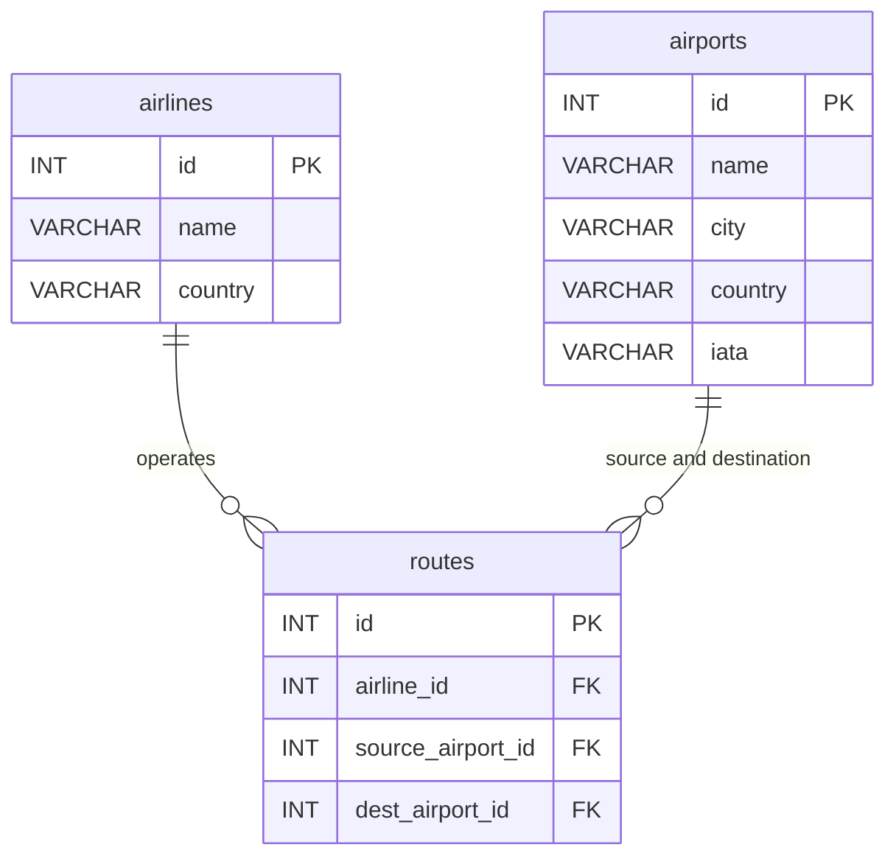

A project for area 1, "SQL that saves you work" for the MariaDB student database projects, 2026-09. ([project page](https://mariadb.org/bachelor_hackathon_2026-09/#1-sql-that-saves-you-work))

# SQL that saves you work — Mighty Coders

Capstone Project I, Constructor University, in partnership with the MariaDB Foundation.

**Team:** Yosief Gebrewahid Kidane, Dinu Panackal Devassia, Timofey Stukalin

For each feature we wrote the same job twice: once the way you had to do it
before (`before.py`) and once with the MariaDB feature (`after.py`). Every
claim below is backed by a script you can run and a test that checks it.
Developed and tested against **MariaDB 11.4** (Docker image `mariadb:11.4`).

**The path in short:** clone → `cp .env.example .env` → `docker compose up -d`
(MariaDB 11.4, loads the data) → `pip install -r requirements.txt` → `pytest`
(115 passed) → run any `before.py` / `after.py` pair. Step by step:
[Run it](#run-it).

**Contents:**
[What we found](#what-we-found) ·
[Data model](#data-model) ·
[Run it](#run-it) ·
[Benchmark](#benchmark) ·
[Examples to paste](#examples-to-paste-into-your-own-schema) ·
[Repository layout](#repository-layout) ·
[How it was made](#how-it-was-made) ·
[Who did what](#who-did-what)

---

## What we found

| # | Feature | What it replaces | What we found | Worth it when | Not worth it when | Demo | Tests |
|---|---|---|---|---|---|---|---|
| 1 | `INET4` / `INET6` | `VARCHAR(45)` for addresses | Stored in 4 / 16 bytes (measured in the [benchmark](#benchmark)). Sorts numerically (as text, `'8.8.8.8'` sorts after `'192.168.1.10'`). Invalid values are rejected with error 1292. | A column holds IP addresses. | The column must also hold free text such as `'unknown'`; the engine rejects it. | `python/inet/`, `python/ip_addresses/` | 24 |
| 2 | `UUID` | `CHAR(36)` | 16 bytes instead of 36 (measured in the [benchmark](#benchmark)). Invalid values are rejected. `DEFAULT UUID()` fills the column. | Ids must be unique across systems. | A plain `INT` is enough; a UUID costs 16 bytes against 4. | `python/uuid_type/` | 5 |
| 3 | `RETURNING` | `INSERT` + a second `SELECT` | One statement, one round trip, half the statements (see [benchmark](#benchmark)). Each statement returns only its own rows. | You need the generated id or the deleted rows back. | You need it on `UPDATE`: **`UPDATE ... RETURNING` needs 13.0, error 1064 on 11.4.** | `python/returning/`, `python/flight_returning/` | 16 |
| 4 | `CREATE SEQUENCE` | One `AUTO_INCREMENT` per table | One counter shared by several tables; `CYCLE`, `SETVAL` and `DEFAULT (NEXT VALUE FOR ...)` work as tested. **Not transactional:** a rolled-back `INSERT` keeps its number used, so the next row leaves a gap. | Two or more tables need ids from the same series. | One table: `AUTO_INCREMENT` is simpler. Numbers must be gapless (for example invoice numbers). | `python/sequence/` | 11 |
| 5 | `INTERSECT` / `EXCEPT` | `JOIN` / `NOT IN` boilerplate | The intent is readable from the operator name. Demo uses the real OpenFlights routes. | "In both A and B" or "in A but not B". | A query that already needs a `JOIN` for other columns. | `python/intersect_except/` | 5 |
| 6 | `CREATE OR REPLACE` | `DROP TABLE IF EXISTS` + `CREATE` | One statement; plain `CREATE` fails with error 1050. **Not atomic**, and it **fails with error 1451 if a foreign key points at the table.** | Re-runnable migration and demo scripts. | The table holds data you want to keep, or other tables reference it. | `python/create_or_replace/` | 6 |
| 7 | `IS JSON` | application-side validation | **`IS JSON` needs MariaDB 12.3.1 ([MDEV-37072](https://jira.mariadb.org/browse/MDEV-37072)); on 11.4 we use `CHECK (JSON_VALID(...))`**, which rejects bad documents at `INSERT`. | A `JSON` column must never hold invalid text. | You pin a server older than 12.3 and want the SQL-standard syntax. | `python/json_check/` | 10 |
| 8 | Invisible columns | A new column that breaks `SELECT *` and column-less `INSERT` | An `INVISIBLE` column leaves both untouched but is usable by name. | Adding a technical column to a table that old code still reads. | New code that should see the column anyway. | `python/invisible_columns/` | 6 |
| 9 | `ROW` type | One `DECLARE` per column in a procedure | One `ROW` variable; `ROW TYPE OF airlines` takes its shape from the table. | A procedure fetches a whole row. | The procedure needs one or two columns. | `python/row_type/` | 9 |
| 10 | Instant `ADD` / `DROP` / `MODIFY COLUMN` | Table-copy `ALTER` | `ALGORITHM=INSTANT` changes only the definition: on 308,100 rows it took 3.7 ms against 183.7 ms for `ALGORITHM=COPY` (49x) (see [benchmark](#benchmark)), and the copy grows with the table. A type change is refused with error 1846 instead of silently copying. | A column is added, dropped or widened on a large, busy table. | The change is a type change (it cannot be instant), or the table is small enough that a copy does not matter. | `python/instant_alter/` | 6 |
| 11 | Progress reporting | A silent `ALTER TABLE` | The process list reports the statement while `ADD INDEX ... ALGORITHM=INPLACE, LOCK=NONE` runs on 300,000 rows. The demo's monitor prints what a second connection sees; in our runs on 11.4 that was state `altering table`, stage 0/0 and no percentage. | A long `ALTER` runs and you want to know it is alive. | You expect a percentage bar on 11.4; we did not see one. | `python/progress_reporting/` | 10 |
| 12 | Global temporary tables | Per-session `TEMPORARY TABLE` | **Not available.** `CREATE GLOBAL TEMPORARY TABLE` fails with error 1064 on 11.4 ([MDEV-35915](https://jira.mariadb.org/browse/MDEV-35915)). The demo captures the real error. | — | — | `python/global_temp/` | 3 |
| 13 | `UPDATE` / `DELETE` from a CTE | Nested `WHERE IN (SELECT ...)` | **`WITH ... UPDATE` needs 12.3; on 11.4 it fails with error 1064.** On 11.4 the same job works with `UPDATE ... JOIN (SELECT ...) AS name`, which also names the filter. | You can run 12.3, or accept the `JOIN` form. | The filter is a plain condition on the same table: `UPDATE ... WHERE` is shorter. | `python/cte_update_delete/` | 4 |

Features 12 and 13 are marked for 12.3 on the project page, and `IS JSON` (7)
also arrived in 12.3.1. We pin 11.4, so the demos show what works there and
record exactly where a newer server is needed. Global temporary tables are not
in 12.3 either: [MDEV-35915](https://jira.mariadb.org/browse/MDEV-35915) is
still open and targets 13.3. Test counts add up to **115**.

---

## Data model

The demos run on the public [OpenFlights](https://github.com/jpatokal/openflights)
data (Open Database License), committed in `data/` and loaded on first start.
All demos read from these tables, so no demo needs internet once the setup is done:



7,698 airports, 6,162 airlines, 66,316 routes.

Why this data: it is real, it has foreign keys (needed to show the
`CREATE OR REPLACE` limit with error 1451), and it is large enough for the
benchmark and the `ALTER TABLE` progress demo. `routes.csv` has 67,663 lines;
`sql/init/12_flight_dataset.sql` loads them through a staging table and keeps
the 66,316 whose airline and airport ids are numeric and exist, so the
foreign keys hold.

Each smaller feature uses its own small demo table (`ip_addresses`,
`connections_old` / `connections_new`, `sessions_old` / `sessions_new`,
`sequence_auto_a` / `_b`, `invisible_old` / `_new`, `team_members`, ...), so
no demo changes another's data.

**Schema:** all of it is in [`sql/init/`](sql/init/), 14 files. MariaDB runs
them in alphabetical order on first start of an empty volume, and the first
error stops the rest, which is why the files carry number prefixes.

---

## Run it

Requirements: [Docker Desktop](https://www.docker.com/products/docker-desktop/)
installed and running, and Python 3.12 or newer (tested with 3.12 and 3.14).

1. Clone the repository and go into it:

   ```bash
   git clone https://github.com/tstukalin1/mighty_coders_capstone.git
   cd mighty_coders_capstone
   ```

2. Create the environment file. The defaults work as they are; change
   `DB_PORT` only if port 3307 is already taken on your machine:

   ```bash
   cp .env.example .env
   ```

3. Start MariaDB 11.4. On first start it runs every file in `sql/init/` and
   loads the OpenFlights data, which takes about a minute:

   ```bash
   docker compose up -d
   ```

4. Create a Python virtual environment:

   ```bash
   python -m venv .venv
   ```

5. Activate it:

   ```bash
   source .venv/bin/activate        # macOS / Linux
   .venv\Scripts\activate           # Windows
   ```

6. Install the dependencies:

   ```bash
   pip install -r requirements.txt
   ```

7. Check the connection. Expected output: `Connected! MariaDB version: 11.4.x-MariaDB-...`

   ```bash
   python db.py
   ```

8. Run the tests. Expected output: `115 passed`:

   ```bash
   pytest
   ```

9. Run a demo. Every feature has a `before.py` and an `after.py`; the
   [demo index](python/README.md) lists all of them:

   ```bash
   python python/returning/before.py
   python python/returning/after.py
   ```

10. Run the benchmark (see [Benchmark](#benchmark)):

    ```bash
    python benchmark.py
    ```

**Start again from clean data:** this deletes the database volume and rebuilds
it from `sql/init/`:

```bash
docker compose down -v
docker compose up -d
```

**Stop the database** (keeping the data):

```bash
docker compose down
```

Every demo creates its own tables and most drop them again, so you can run
any demo more than once.

---

## Benchmark

`benchmark.py` makes three measurements:

1. **Statements and time saved.** `INSERT ... RETURNING` against `INSERT` + `SELECT`
   on the real `airlines` table: 5 rounds of 200 operations per approach, the
   order alternating every round, mean and standard deviation reported.
2. **Bytes saved.** The same 100,000 values stored as `VARCHAR(45)` against `INET4`
   and as `CHAR(36)` against `UUID`, each table with an `INT` primary key and an
   index on the value. Table size (data + index) comes from
   `information_schema.tables` after `ANALYZE TABLE`.
3. **Migration time.** `ADD COLUMN` with `ALGORITHM=COPY` against
   `ALGORITHM=INSTANT` on about 300,000 rows (the airlines repeated 50 times),
   5 rounds, order alternating, mean and standard deviation reported.

```bash
python benchmark.py
```

Results from one run on a MacBook Air (Python 3.14, Docker `mariadb:11.4`, client and server on the same machine):

**`RETURNING` against `INSERT` + `SELECT`** (200 operations per round, 5 rounds, order alternated):

| Approach | Statements per operation | Mean per operation | Std dev |
|---|---|---|---|
| `INSERT` + `SELECT` (old way) | 2 | 0.323 ms | 0.019 ms |
| `INSERT ... RETURNING` | 1 | 0.185 ms | 0.005 ms |

`RETURNING` was 42.6% faster per operation and sent half as many statements.

**Storage** for 100,000 rows (`id` + value + index on the value):

| Stored as | Table size | Saved vs text |
|---|---|---|
| `VARCHAR(45)` | 9.03 MB | |
| `INET4` | 6.03 MB | 33.2% |
| `CHAR(36)` | 12.03 MB | |
| `UUID` | 8.03 MB | 33.2% |

**Migration time:** `ADD COLUMN` on 308,100 rows (5 rounds, order alternated):

| Algorithm | Mean | Std dev |
|---|---|---|
| `ALGORITHM=COPY` (old way: the table is rebuilt) | 183.7 ms | 3.2 ms |
| `ALGORITHM=INSTANT` | 3.7 ms | 1.8 ms |

`INSTANT` was 49x faster. A copy rewrites every row, so its time grows with
the table; an instant change only rewrites the definition.

Timings will differ on another machine, so run `python benchmark.py` to
reproduce them; the statement counts and the storage sizes should match.
The numbers above come from one run of `python benchmark.py`.

Client and server share one machine, so network latency is close to zero and
the `RETURNING` saving is a **lower bound**: each saved statement also saves a
network round trip on a real deployment. The storage figures include the
primary key, so the saving on the value column alone is larger than the table
percentage.

---

## Examples to paste into your own schema

Run the blocks in order in an empty database (blocks 3 and 5 use the `customers` table from block 1). They are
short versions of the demos in `python/` and the scripts in `sql/init/`.

```sql
-- 1. RETURNING: get the new row back from the INSERT itself (no second SELECT)
CREATE TABLE customers (id INT AUTO_INCREMENT PRIMARY KEY, name VARCHAR(100));
INSERT INTO customers (name) VALUES ('Ada') RETURNING id, name;

-- 2. INET4: addresses that sort as numbers and reject bad input
CREATE TABLE visits (ip INET4 NOT NULL);
INSERT INTO visits VALUES ('192.168.1.10'), ('8.8.8.8'), ('10.0.0.1');
SELECT ip FROM visits ORDER BY ip;   -- 8.8.8.8, 10.0.0.1, 192.168.1.10

-- 3. Invisible column: SELECT * and INSERT without a column list keep working
ALTER TABLE customers ADD COLUMN created_at TIMESTAMP INVISIBLE DEFAULT CURRENT_TIMESTAMP;
INSERT INTO customers VALUES (NULL, 'Bob');   -- the old INSERT still works
SELECT * FROM customers;                      -- still only id, name
SELECT name, created_at FROM customers;       -- visible when named

-- 4. One sequence shared by two tables
CREATE SEQUENCE order_no START WITH 1000;
CREATE TABLE web_orders  (no INT PRIMARY KEY DEFAULT (NEXT VALUE FOR order_no), item VARCHAR(50));
CREATE TABLE shop_orders (no INT PRIMARY KEY DEFAULT (NEXT VALUE FOR order_no), item VARCHAR(50));
INSERT INTO web_orders  (item) VALUES ('book');   -- no = 1000
INSERT INTO shop_orders (item) VALUES ('pen');    -- no = 1001

-- 5. Instant ADD COLUMN: an error instead of a silent table copy if it cannot be instant
ALTER TABLE customers ADD COLUMN email VARCHAR(150), ALGORITHM=INSTANT;
```

---

## Repository layout

| Path | What it holds |
|---|---|
| `sql/init/` | The schema and data: 14 numbered SQL files |
| `data/` | OpenFlights CSV files |
| `python/<feature>/` | `before.py` and `after.py` for each feature ([index](python/README.md)) |
| `tests/` | 115 pytest tests; `conftest.py` gives each test one connection and rolls back |
| `benchmark.py` | Statements, bytes and migration time, with repeated runs |
| `.github/workflows/tests.yml` | CI: starts MariaDB 11.4 and runs `pytest` on every push and pull request |
| `db.py` | Connection helper; reads credentials from `.env` |

The credentials in `.env.example` are local demo values for a throwaway
container, not secrets. All values reach the server through query parameters.

---

## How it was made

- **Method.** For every feature we wrote the same job twice, `before.py` and
  `after.py`, and checked each claim in this README with a pytest test against
  the real server. Where a feature turned out not to work on 11.4, we kept the
  demo and recorded the real error and the version that adds it.
- **Measurements.** `benchmark.py` repeats every timing in several rounds with
  alternating order and reports the spread; storage comes from the server's own
  `information_schema`.
- **Checks.** CI starts a fresh MariaDB 11.4 from `sql/init/` and runs all tests
  on every push and pull request, so the setup above is tested from zero.

---

## Who did what

| Member | Work (from the git history) |
|---|---|
| Yosief Gebrewahid Kidane | Instant `ALTER` (`14_instant_alter.sql`, demos, tests, migration benchmark), `CREATE OR REPLACE`, `RETURNING`, `CREATE SEQUENCE`, invisible columns, global temporary tables (limit), the OpenFlights dataset (`12_flight_dataset.sql`) and `benchmark.py`, the final `ROW` type and progress-reporting demos and tests, the `ip_addresses` before/after demo and tests, and the test fixture shared by all tests |
| Timofey Stukalin | `UUID`, `INTERSECT` / `EXCEPT`, CTE `UPDATE` / `DELETE`, `IS JSON` check (`02_isjson_check.sql`, `test_products.py`), `INET` before/after (`03_inet.sql`, `python/inet/`), first versions of `docker-compose.yml` and `db.py` |
| Dinu Panackal Devassia | `INET4` / `INET6` table and data (`01_inet.sql`); early drafts of the `ROW` type and progress reporting, replaced by the final versions above |

The full history, with every pull request and review, is in the repository.
